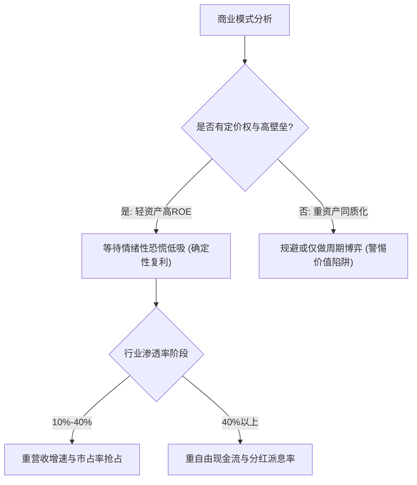

# 框架：Aili 商业壁垒与成长股估值锚点模型 (Aili Moats & Valuation Framework)

- **ID**: `fw_aili_valuation_001`
- **Topic**: aili
- **Version**: 1.0.0
- **Status**: verified

## 1. 核心论点 (Core Thesis)
投资最核心的确定性来自于企业的“自由现金流创造能力”与“不可替代的护城河”。对于成长股，不能静态看待单一 PE 倍数，必须结合行业所处的生命周期渗透率（S 曲线），在“杀估值但商业逻辑未破”的恐慌窗口建立足够的安全边际。

## 2. 关键变量 (Key Variables)
- **自变量**: 行业渗透率(S-Curve)、资本开支占营收比(CapEx/Sales)、提价能力(Gross Margin韧性)。
- **中介变量**: 客户转移成本、自由现金流转化率(FCF Conversion)、竞争格局CR3集中度。
- **因变量**: ROIC(投入资本回报率)、可持续ROE水平、远期折现估值倍数。

## 3. Aili 四象限评估法

## 4. 关键证伪与卖出红线 (Falsification & Exit Triggers)
1. 核心壁垒坍塌（如核心技术被平替、大客户流失、依靠价格战维持微薄营收）；
2. 现金流与净利润持续背离（应收账款和存货非正常飙升）；
3. 估值透支未来3-5年所有乐观预期（PEG > 3.0 且行业渗透率见顶）。

## 5. 关联引证 (Source Citations)
- 视频记录: `vid_aili_2024_02_18`, `vid_aili_2024_03_05`
- 支撑主张: `clm_aili_001`, `clm_aili_002`, `clm_aili_003`
