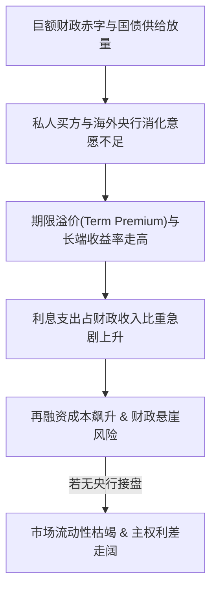

# 框架：主权债务与长端国债收益率上行传导机制 (Sovereign Debt & Long-Term Yields)

- **ID**: `fw_sovereign_debt_001`
- **Topic**: sovereign_debt
- **Version**: 1.0.0
- **Status**: verified

## 1. 核心论点 (Core Thesis)
当主权国家财政赤字居高不下、债务存量突破临界阈值时，国债供应泛滥将推升期限溢价（Term Premium）。在此背景下，若央行为了抗通胀无法开启大规模量化宽松（QE）接盘，长端收益率的无序攀升将引发“利息支出激增 → 赤字扩张 → 更多发债 → 收益率进一步走高”的恶性利息螺旋。

## 2. 关键变量 (Key Variables)
- **自变量**: 财政赤字占GDP比例、国债发行规模与期限结构、央行资产负债表缩表进度（QT）。
- **中介变量**: 期限溢价（ACM模型估算）、美债一级交易商（Primary Dealers）资产负债表承载力、外资官方购债净额。
- **因变量**: 10年期/30年期国债收益率、企业与居民实际借贷成本、主权CDS利差。

## 3. 因果传导链条 (Causal Transmission Chain)

## 4. 关键触发与证伪条件 (Triggers & Falsification Conditions)
- **危机发酵触发点**: 10年期国债收益率持续高于名义GDP增速（r > g），且财政初级赤字（Primary Deficit）无法收敛。
- **证伪/缓解指标**: 
  1. 央行重启买债或变相实施收益率曲线控制（YCC）；
  2. 财政部大幅将发债重心转向短端国库券（T-Bills），抽水逆回购（RRP）资金缓冲长端冲击。

## 5. 历史对比与案例 (Historical Case References)
- **2011年欧洲主权债务危机 (PIIGS)**: 希腊、意大利缺乏独立货币发行权，无法自主印钞稀释债务，最终爆发偿债危机与利差暴涨。
- **美法国债异同**: 美国拥有全球储备货币霸权与美元回流机制，爆发直接硬违约的概率极低，但长端收益率高企会重压美股估值与银行业未实现亏损；法国受制于欧盟《稳定与增长公约》及欧洲央行统一监管，财政自主度较低，长端溢价对其财政预算约束更强。

## 6. 关联引证 (Source Citations)
- 视频记录: `vid_macro_2023_09_15`, `vid_macro_2024_01_20`
- 支撑原子主张: `clm_001`, `clm_002`, `clm_005`
